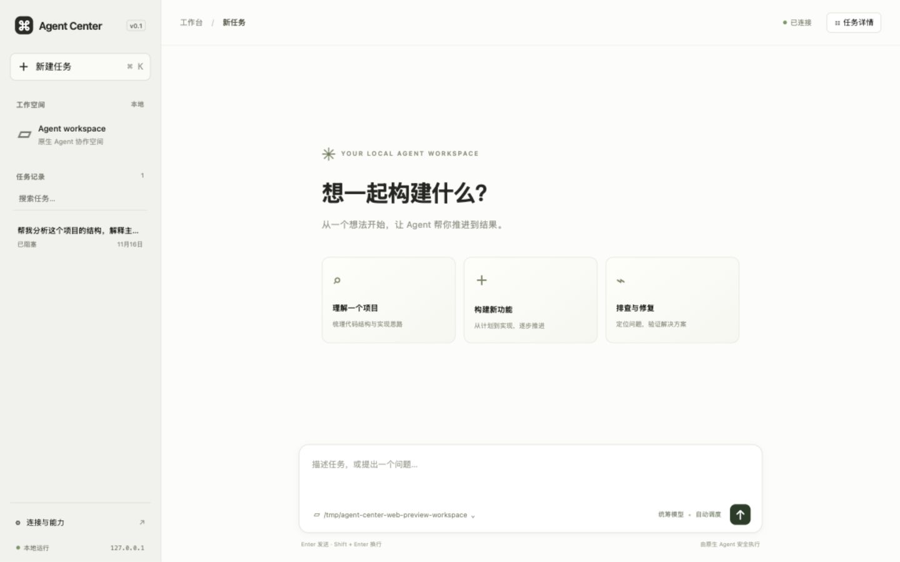

# Agent Center

A local macOS-first coordinator for a configured supervisor API and two independently configured CLI agents. The project is being implemented in stages; the real Codex and DeepSeek headless protocols are not declared supported until local compatibility evidence exists.

Before creating any task or execution workspace, the supervisor model decides whether to answer directly or request a CLI task using the current conversation context. Ordinary Q&A uses one supervisor response and stays in a separate, durable conversation. No local keyword rules or complexity classifier preselect execution. Once the model saves a plan or starts execution, the existing verification requirements apply before reporting completion.

## Requirements

- Python 3.14 (see `.python-version`) and `uv`.
- A private TOML config copied from `config.example.toml` to `~/.agent-center/config.toml` or selected with `--config`.
- Supervisor URL, API key and model saved once through the local settings form, or supplied through the environment variables named by that config. Never put secret values into TOML or reports.
- A compatible Codex and DeepSeek Harness headless adapter. `doctor` reports local paths and static compatibility without making paid API calls.

## Install and inspect

```sh
uv sync --locked
uv run --locked agent-center --help
uv run --locked agent-center doctor
uv run --locked agent-center agents
uv run --locked pytest -m 'not live'
```

The project does not change either CLI's configuration. Real CLI/API calls are opt-in and are not run by ordinary tests.

## Browser workbench

Start the local Codex-inspired interface:

```sh
uv run --locked agent-center web
```

This opens `http://127.0.0.1:8765` in your browser. Use `--port 8766` to change the port, or `--no-browser` to start without opening a tab. Global options go before `web`, for example `agent-center --config /absolute/path/config.toml web`.

The interface provides task history/search, task creation with workspace selection, persisted follow-up messages, pause/stop/cancel/resume, Plan/Run/budget details, verification evidence, event logs and approval review. Enter sends; Shift+Enter inserts a newline; Cmd/Ctrl+K opens a separate conversation, including while a task is active. Task state refreshes every 2.5 seconds. Execution still uses the existing TaskEngine and native capability gates.

Without a config, the UI opens in offline mode and can display history; submitting a message preserves it with a connection error and creates no task. Configure the supervisor endpoint/key/model and verified Agent capabilities before real execution. The UI does not enable disabled Agents. Blocked tasks show their reason; unresolved Runs must be reviewed and explicitly reconciled in the task details. Approval records cannot grant permissions the native CLI cannot enforce.

The server binds only to loopback and uses same-origin/Host checks plus a per-process CSRF token for mutations. Keep this local service on your own machine; it has no remote-user authentication. No Node build or additional runtime is required.



## Add an installed Agent

Web: open **连接与能力 → 添加 Agent**, select Codex CLI or DeepSeek Harness, click **自动检测安装** (or browse for the executable), and enter the actual model ID. DeepSeek additionally requires a provider route and its package directory containing `lib/bin.js`; Electron ASAR paths can be entered directly. Saving updates the running web service immediately. Replacing an existing configured Agent requires the replacement checkbox.

CLI interactive wizard (detects common installation paths):

```sh
uv run --locked agent-center agent add codex
uv run --locked agent-center agent add deepseek
```

Noninteractive examples (replace model IDs with ones available in your CLI):

```sh
uv run --locked agent-center agent add codex --executable /absolute/path/to/codex --model YOUR_MODEL_ID
uv run --locked agent-center agent add deepseek --executable "/Applications/DeepSeek Harness.app/Contents/MacOS/DeepSeek Harness" --cli-install-dir "/Applications/DeepSeek Harness.app/Contents/Resources/app.asar/dsh/node_modules/@deepseek-ai/dsh" --provider deepseek-official --model YOUR_MODEL_ID
```

Use `--replace` to explicitly replace an existing Agent. The default permission is read-only; `--permission-mode workspace-write` records the requested native mode. This registers existing software, without downloading it or editing either native CLI config. The CLI uses credential environment variables; the web form optionally accepts a key for the current server process only, without persisting it. Registration resets capabilities to UNVERIFIED and execution stays disabled until native boundaries are verified.

Registration settings are stored atomically with mode 0600 in `config.toml.agents.json` alongside the selected Agent Center TOML (default `~/.agent-center/config.toml.agents.json`). The original TOML is preserved. CLI and web both reload these settings, including when the base TOML has not yet been created; supervisor configuration is still needed for real tasks. Running tasks and unresolved Runs block connection edits. Idle tasks allow adding a new Agent; replacing an existing connection is allowed before any Run or approval exists. Otherwise open the blocking task, stop if necessary, review/reconcile its Runs, and cancel it before replacing settings. If the web server holds the data-directory lock, use its settings panel or stop it before using the CLI wizard.

Workspace selection: click **自动创建工作区 → 浏览文件夹…**, navigate folders, then **选择此文件夹** (applies immediately and returns to the composer). The same picker can select Agent executables and package directories. Absolute-path entry remains available. The picker lists names and paths on this local machine, without uploading files or reading their contents; it is a user-facing management action, not a model tool.

## Commands

```text
agent-center web [--port 8765] [--no-browser]
agent-center doctor [--live]
agent-center agents
agent-center run "task" [--workspace PATH]
agent-center chat [--workspace PATH]
agent-center history
agent-center show TASK_ID
agent-center logs TASK_ID [--verbose]
agent-center resume TASK_ID
agent-center cancel TASK_ID --yes
```

`--live` is an explicit real-service probe and can incur provider usage. It must not be used unless local credentials, budget, and authorization are in place. At present, do not assume the live path is compatible; consult `docs/COMPATIBILITY.md` and `docs/ACCEPTANCE_REPORT.md`.

### Connection form and server upgrades

Choosing Codex or DeepSeek in the web form now detects its installation automatically. Manual executable/package paths live under advanced settings. Model ID is the exact model name supplied by your model service; Base URL is its API root, not its website. Codex supports its existing official login or a custom Responses-compatible endpoint. DeepSeek uses the Harness provider route and `DEEPSEEK_BASE_URL` for an explicitly configured endpoint.

For custom APIs, select the credential environment variable (Codex: `OPENAI_API_KEY` or `CODEX_API_KEY`; DeepSeek: `DEEPSEEK_API_KEY`) and set its value in the terminal before starting the web server. You may also paste an API key in the web form for the current server process only. The input is cleared after saving; keys are never written to registration files or returned by the API. Restarting the server discards these session keys. CLI registration accepts the same `--base-url` and `--api-key-env` options. Endpoint overrides apply only to that Agent invocation, with no native config changes. Live authentication/model routing remains unverified until separately tested.

After updating source, restart `agent-center web` and refresh the page. The server now holds a matching frontend snapshot for its lifetime, and the frontend checks API revision so a stale backend produces a restart instruction instead of a blank picker. File selection lists folders for workspaces, and executable files for CLI selection; enable “显示隐藏目录” to navigate `.local` or other hidden installation folders.

### Codex subscription login

The Agent form defaults to **Codex 订阅登录** and reuses local Codex authentication. No Base URL or API key is required. Leave the model field empty to use Codex's default model; the adapter omits `--model` in this case. API fields appear only for a custom API connection. Manual paths, permissions and replacement options are collapsed under advanced settings.

### Model and reasoning selection

Opening the Add Agent form detects the installation and reads its model catalog automatically. Codex subscription models and supported reasoning efforts come from the CLI's native `app-server` `model/list` response. DeepSeek uses the installed Harness provider's native model/effort metadata, labeled as a local catalog rather than account authorization. Custom API connections query their `/models` endpoint only after the user supplies the address; no redirects are followed with credentials. If the endpoint provides no reasoning metadata, the selector offers only model default. Detection failure permits an explicit manual Model ID; it never presents a hardcoded list as discovered.

Choosing a model updates the reasoning selector to that model's declared choices. Both values are saved in the registration and passed to the existing CLI adapters. Interactive CLI registration also presents the native catalog and reasoning choices; scripted registration accepts `--model` and `--reasoning-effort`. Catalog discovery creates no task/thread and runs no project code.

“CLI 程序位置” is the installed CLI launcher, such as the `codex` executable resolved from PATH or the DeepSeek Harness app launcher. It is not the task workspace. Normally automatic detection fills it in and there is no need to edit it.

### Supervisor settings and task recovery

Open **连接与能力 → 配置统筹模型** (also available from the composer) to select the supervisor API protocol, model and optional reasoning effort, timeout and output limit. This is separate from Agent profiles. The existing `config.toml.agents.json` supervisor overlay remains readable for compatibility; new saves preserve the base TOML, including when it does not exist yet. Address, key and supervisor options are atomically saved in `config.toml.supervisor.json` next to the selected config, with file mode 0600 (new parent directories use 0700). Settings reload on restart, including without a base TOML. The sidecar is a local plaintext secret store protected by filesystem permissions; no credentials enter browser localStorage, API responses, task snapshots or native Agent environments. The form never displays existing address/key values; blank inputs preserve them. Saved values take precedence over the named environment variables. `--config` / `AGENT_CENTER_CONFIG` select this sidecar; `--data-dir` changes SQLite/runtime storage only and leaves the config-scoped connection intact. Supervisor variables cannot overlap Agent credential variables.

The workbench keeps **独立会话** separate from **任务记录**. **新建会话** always opens a separate context; selecting a task explicitly changes the composer to append requirements to that task. A CLI request blocked by an existing task or unreconciled Run stays in its conversation with the blocking task ID and a retry button. Retrying uses the saved execution decision without another routing call. Questions remain answerable while another task is active. CLI `run` and plain text in `chat` use the same pre-task route; `/add` appends to the selected task, `/ask` asks about that task, and `/new` clears only the conversation context. Paused tasks can resume on a follow-up. Blocked or interrupted tasks show **检查与对账**: inspect Run status, log paths and workspace effects, confirm processes have stopped, and type the task ID. Live or ambiguous process identities prevent reconciliation. Reviewed Runs are recorded as reconciled, with original state saved in the event history; old Runs are never replayed. Continue creates a fresh plan, or cancel to release the task slot. No task is silently cancelled and budgets/evidence/history are retained.

Before any Agent is added, the settings panel shows an empty state, **添加 Agent**, and the separate supervisor settings entry. Installation discovery is used only in the Add Agent flow. Explicit registrations and legacy concrete-model TOML entries remain visible; offline placeholder defaults do not count as added. The settings panel shows connection health and essential identity only for added Agents. Expand **能力与安装详情** for capability evidence and installation identity; a configured connection is not proof of live API availability.


Task details include **删除任务** with confirmation. Deletion transactionally removes task records, messages, approvals, events, Run metadata and evidence links; conversation history remains with its task link cleared. Workspace files and existing log files remain untouched. Active jobs, unsettled execution periods, unknown/unreconciled Runs and incomplete failed Runs prevent deletion; stop, review/reconcile, and cancel first. Missing tasks return an explicit error.

The supervisor currently supports OpenAI-compatible Chat Completions only. Automatic reasoning omits `reasoning_effort`. Explicit effort is validated against known model support (o3/o4-mini; GPT-5/mini/nano; GPT-5.1/5.2); unknown model IDs must use automatic. Unsupported choices produce a local error before any HTTP request. Legacy config files still load so their choices can be repaired. Reasoning models use `max_completion_tokens` and omit temperature. Parameter references: official OpenAI documentation for [Chat Completions](https://developers.openai.com/api/reference/resources/chat/subresources/completions/methods/create), [GPT-5](https://developers.openai.com/api/docs/models/gpt-5), [GPT-5.1](https://developers.openai.com/api/docs/models/gpt-5.1), and [GPT-5.2](https://developers.openai.com/api/docs/models/gpt-5.2). This validation does not certify third-party provider compatibility.

The workbench contract is API revision **4**; server and UI must be updated together. Conversation context is bounded by the existing model-input byte limit; an over-limit message remains saved with an instruction to open a new conversation.
